<!-- ===================== BANNER (auto light / dark) ===================== -->
<div align="center">

<picture>
  <source media="(prefers-color-scheme: dark)" srcset="./assets/banner-dark.svg">
  
</picture>

<br/>

<a href="https://git.io/typing-svg">
  
</a>

<p>
  
  
</p>

<i>I build backend systems that scale — Spring Boot, Node.js, microservices — and love plugging AI into real products.</i>

</div>

<br/>

<!-- ===================== BENTO / AT A GLANCE ===================== -->
<table>
<tr>
<td width="50%" valign="top">

```python
class ThanhDuy(Engineer):
    role   = "Software Engineer"
    school = "HCMUTE"
    stack  = ["Java", "Python", "JS"]
    loves  = ["Backend",
              "Microservices",
              "AI / NLP",
              "System Design"]

    def motto(self):
        return "learn → build → ship"
```

</td>
<td width="50%" valign="top">

#### 🩷 Now
**Software Engineer @ Amaris Consulting**<br/>
Consulting on a Bosch project

#### 🌱 Learning
Microservices architecture

#### 💬 Ask me about
Spring Boot · Node.js · System design

#### 🔢 By the numbers
**6** programming languages · **24** tools in the belt

</td>
</tr>
</table>

<!-- ===================== TOOLBOX ===================== -->
## 🧰 The toolbox

| | |
|:--|:--|
| **languages** |       |
| **backend** |    |
| **frontend** |     |
| **data** |     |
| **devops & tools** |        |

<!-- ===================== PROJECTS ===================== -->
## 🚀 Things I've built

<table>
<tr>
<td width="50%" valign="top">

`01` · **AI · NLP**
### CV – Job Matching Platform
Matches candidates to jobs with NLP — smart ranking and automated screening.

`Python` `NLP` `ML`

</td>
<td width="50%" valign="top">

`02` · **FULL-STACK**
### Building Management System
Real-time monitoring and automated workflows for managing buildings.

`Spring Boot` `React` `MySQL`

</td>
</tr>
<tr>
<td width="50%" valign="top">

`03` · **DISTRIBUTED**
### Microservices Backend
Clean-architecture services built for high availability and scale.

`Spring Boot` `Docker` `Redis` `MongoDB`

</td>
<td width="50%" valign="top">

`04` · **WEB**
### Full-stack Web Apps
Responsive apps with clean UI and well-structured RESTful APIs.

`React/Vue` `Node.js` `Express`

</td>
</tr>
</table>

<div align="right"><a href="https://github.com/Killig3110?tab=repositories">all repos →</a></div>

<!-- ===================== STATS (auto light / dark) ===================== -->
## 📈 GitHub activity

<div align="center">

<picture>
  <source media="(prefers-color-scheme: dark)" srcset="https://github-readme-stats.vercel.app/api?username=Killig3110&show_icons=true&theme=radical&hide_border=true&bg_color=0D1117">
  
</picture>
<picture>
  <source media="(prefers-color-scheme: dark)" srcset="https://github-readme-stats.vercel.app/api/top-langs/?username=Killig3110&layout=compact&theme=radical&hide_border=true&bg_color=0D1117">
  
</picture>

<picture>
  <source media="(prefers-color-scheme: dark)" srcset="https://streak-stats.demolab.com?user=Killig3110&theme=radical&hide_border=true&background=0D1117">
  
</picture>

</div>

<!-- ===================== CONNECT ===================== -->
## 💌 Let's build something cool.

<p>
  <a href="mailto:killig.3110@gmail.com"></a>
  <a href="https://fb.com/killig.3110"></a>
  <a href="https://instagram.com/thanhdii.3110"></a>
  <a href="https://github.com/Killig3110"></a>
</p>

<div align="center">

<sub>thanks for dropping by 🩷 happy coding</sub>


</div>
