<!-- ===================== BANNER (auto light / dark) ===================== -->

<picture>
  <source media="(prefers-color-scheme: dark)" srcset="./assets/banner-dark.svg">
  
</picture>

 

  
  

<i>I build backend systems that scale — Spring Boot, Node.js, microservices — and love plugging AI into real products.</i>

 

<!-- ===================== BENTO ===================== -->
<picture>
  <source media="(prefers-color-scheme: dark)" srcset="./assets/about-dark.svg">
  
</picture>

 

<!-- ===================== TOOLBOX ===================== -->
<picture>
  <source media="(prefers-color-scheme: dark)" srcset="./assets/toolbox-dark.svg">
  
</picture>

 

<!-- ===================== PROJECTS ===================== -->
<a href="https://github.com/Killig3110?tab=repositories">
<picture>
  <source media="(prefers-color-scheme: dark)" srcset="./assets/projects-dark.svg">
  
</picture>
</a>

 

<!-- ===================== STATS (auto light / dark) ===================== -->
## 📈 GitHub activity

<picture>
  <source media="(prefers-color-scheme: dark)" srcset="https://github-readme-stats.vercel.app/api?username=Killig3110&show_icons=true&theme=radical&hide_border=true&bg_color=0D1117">
  
</picture>
<picture>
  <source media="(prefers-color-scheme: dark)" srcset="https://github-readme-stats.vercel.app/api/top-langs/?username=Killig3110&layout=compact&theme=radical&hide_border=true&bg_color=0D1117">
  
</picture>

<picture>
  <source media="(prefers-color-scheme: dark)" srcset="https://streak-stats.demolab.com?user=Killig3110&theme=radical&hide_border=true&background=0D1117">
  
</picture>

<!-- ===================== CONNECT ===================== -->
<a href="mailto:killig.3110@gmail.com">
<picture>
  <source media="(prefers-color-scheme: dark)" srcset="./assets/connect-dark.svg">
  
</picture>
</a>

 

  
  
  
  

thanks for dropping by 🩷 happy coding

